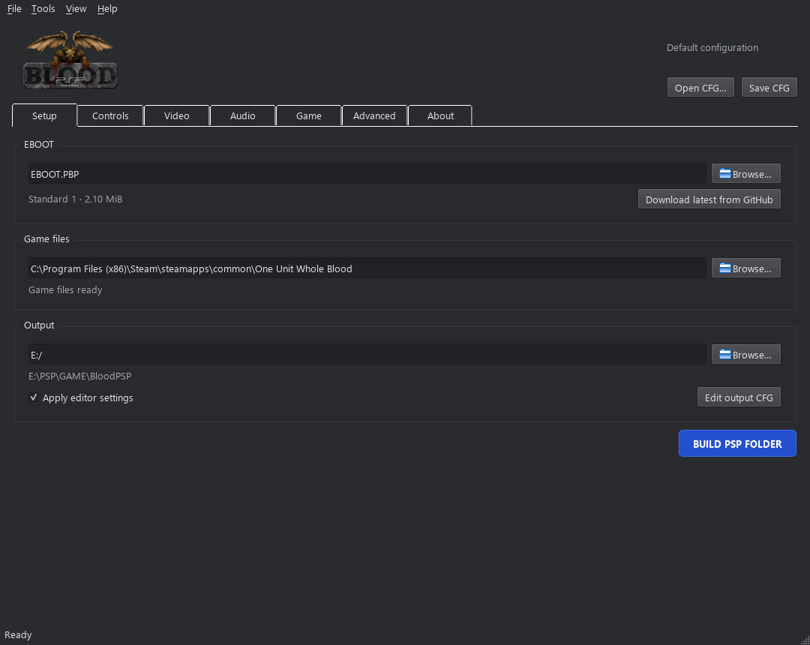
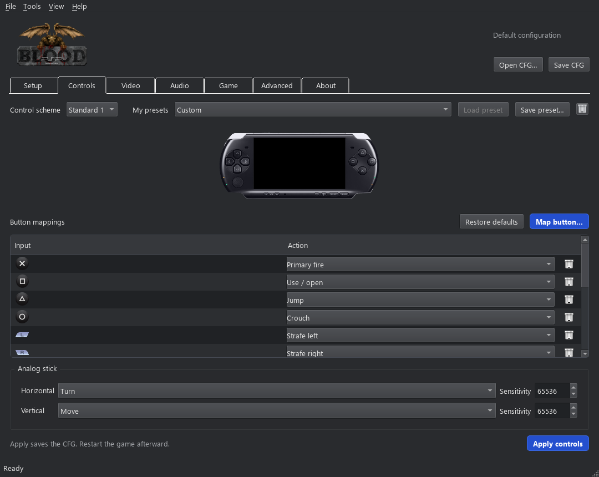

  

# Blood PSP

[English](README.md) | [Português Brasileiro](README.pt-BR.md)

Blood para o PSP, baseado no [jfblood-vita](https://github.com/Rinnegatamante/jfblood-vita) e no [NBlood-Amiga](https://github.com/BSzili/NBlood-Amiga).

Ainda em desenvolvimento. Testado no PSP Slim e no PPSSPP.

## Instalação

Baixe o [GUI para Windows](https://github.com/RainArcanjo/BloodPSP/releases/latest). Com ele você monta a pasta do jogo para o PSP e customiza controles, vídeo, áudio e o `nblood.cfg`.

Compatível com **Blood: Fresh Supply** e **One Unit Whole Blood**. Você precisa ter sua cópia do jogo.

1. Extraia o ZIP e abra `BloodPSPLauncher.exe`.
2. Selecione a pasta onde seu Blood está instalado. A EBOOT já vem junto; também dá para selecionar outra ou baixar do GitHub.
3. Selecione o cartão do PSP ou uma pasta de saída.
4. Clique em **BUILD PSP FOLDER**.
5. Copie a pasta `PSP` gerada para o cartão, caso tenha montado no PC.

Músicas OGG e user maps disponíveis são copiados automaticamente. Os arquivos originais do seu jogo ficam no lugar.

## Controles

Na aba **Controls**, você pode mudar os botões e criar combinações. O **Map button** funciona com DualShock/DualSense ou pelos botões do PSP na tela. Segure os botões juntos e solte.

Use **Save preset** e **Load preset** para guardar seus controles. Com o jogo fechado, clique em **Apply controls** para salvar o CFG e depois abra o jogo.

## User maps

Coloque os arquivos `.MAP` em `PSP/GAME/BloodPSP/usermaps/`. No jogo, abra **NEW GAME > USER MAP**.

Tem suporte a músicas OGG, saves e resolução nativa de 480×272. Você pode usar 320×200 para ganhar desempenho. Multiplayer, vídeos Smacker e voxels ainda não são suportados.

Obrigado ao **wa59** pelos controles, músicas MIDI, correções dos saves e resolução nativa.

[Créditos](CREDITS.md) · [Compilar o projeto](docs/BUILD.md) · [Licença](LICENSE)
