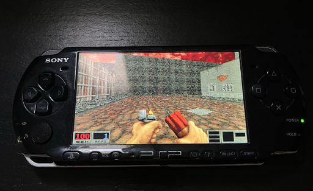

<div align="center">
  
</div>

# Blood PSP

[English](README.md) | [Português Brasileiro](README.pt-BR.md)

Port não oficial e em desenvolvimento de **Blood** para o Sony PlayStation Portable. O EBOOT aparece como **Blood** no menu do PSP.

Blood PSP começou a partir de uma cópia de [jfblood-vita](https://github.com/Rinnegatamante/jfblood-vita), que segue o trabalho [NBlood-to-JFBuild](https://github.com/BSzili/NBlood-Amiga) do BSzili. A lógica do jogo descende de [NBlood](https://github.com/nukeykt/NBlood).

<div align="center">
  
</div>

## Estado atual

Testado em PSP Slim e PPSSPP. Menu, controles, carregamento de fases, jogo, callback de saída para XMB e efeitos sonoros PCM funcionam. A release usa o renderer clássico por software do BUILD. É possível renderizar em 320×200 para maior velocidade ou 480×272 para uma imagem mais nítida.

Este não é um port finalizado. Crashes são esperados porque boa parte do jogo ainda não foi testada, principalmente transições de fase, episódios, saves e combinações de conteúdo incomuns.

Limitações atuais:

- Faixas OGG gravadas podem ser reproduzidas em streaming. Copie `blood02.ogg` até `blood09.ogg` da instalação Steam para a subpasta `music/` ao lado da EBOOT. `CDAudioToggle = 1` seleciona as faixas indicadas por `Track` no `BLOOD.INI`; a introdução usa `blood02.ogg`.
- Música MIDI usa TinySoundFont. Coloque um banco General MIDI pequeno chamado `SOUNDFONT.SF2` ao lado da EBOOT; sem ele, apenas a alternativa MIDI fica sem música (OGG e efeitos continuam funcionando). Prefira bancos de até cerca de 2 MB: os samples ocupam mais RAM depois de carregados.
- Rede, vídeos Smacker e voxels não fazem parte da build atual.
- O renderer de mundo pela GE do PSP é experimental e fica desativado na release estável.


As contribuições de **wa59** estão integradas para teste. A resolução continua selecionável no menu **Options > Display Setup > Video Mode** e em `nblood.cfg`; a configuração distribuída começa em 480×272. A correção de saves restaura os ponteiros do jogador e usa o preload limitado do PSP ao carregar. Essas mudanças precisam de validação no PSP/PPSSPP.

## Instalação

A única versão testada foi *One Unit Whole Blood* da Steam. Copie estes arquivos de uma instalação Steam legal para `ms0:/PSP/GAME/BloodPSP/`, ao lado de `EBOOT.PBP` e `nblood.cfg`:

```text
BLOOD.INI
BLOOD.RFF
GUI.RFF
SOUNDS.RFF
SURFACE.DAT
TABLES.DAT
TILES000.ART
TILES001.ART
TILES002.ART
TILES003.ART
TILES004.ART
TILES005.ART
TILES006.ART
TILES007.ART
TILES008.ART
TILES009.ART
TILES010.ART
TILES011.ART
TILES012.ART
TILES013.ART
TILES014.ART
TILES015.ART
TILES016.ART
TILES017.ART
VOXEL.DAT
```

A pasta Steam testada não possui subpastas obrigatórias. Outras versões e mods ainda não foram testados. Não redistribua dados de Blood junto deste projeto.

## Compilação

Os comandos abaixo usam Bash. No Windows, abra um shell MSYS2; no Linux, use um shell normal. Este repositório não instala PSPDEV automaticamente. Instale primeiro uma toolchain PSPDEV e o PSPSDK.

### 1. Ferramentas necessárias

Os comandos abaixo precisam estar disponíveis no `PATH`:

```text
psp-gcc        psp-g++        psp-ar          psp-ranlib
mksfoex        pack-pbp       psp-prxgen      psp-fixup-imports
```

Também são necessários `make`, `git` e Bash. No MSYS2, use caminhos no formato POSIX, como `/c/pspdev`, e não `C:\pspdev`, ao definir as variáveis abaixo.

### 2. Clonar o código e as bibliotecas

```sh
git clone --recurse-submodules <url-do-seu-fork> Blood-PSP
cd Blood-PSP
```

Se o repositório foi clonado sem submódulos, baixe-os antes de compilar:

```sh
git submodule update --init --recursive
```

### 3. Configurar o ambiente

Defina `PSPDEV` como o prefixo da toolchain. O PSPSDK é esperado em `$PSPDEV/psp/sdk`.

```sh
export PSPDEV=/c/pspdev
export PSPSDK="$PSPDEV/psp/sdk"
export PATH="$PSPDEV/bin:$PSPSDK/bin:$PATH"
```

Troque `/c/pspdev` pelo caminho da sua toolchain. Confirme o ambiente antes de compilar:

```sh
psp-gcc --version
psp-g++ --version
command -v mksfoex pack-pbp psp-prxgen psp-fixup-imports
```

### 4. Gerar a release recomendada

```sh
make -f Makefile.psp PSP_EXTRA_DEFINES=-DPSP_STABLE_PERFORMANCE_BUILD blood-eboot-release
```

Esse alvo força uma recompilação completa de release, portanto não reutiliza objetos de uma build diagnóstica. Ele ativa o perfil estável com renderer por software e suprime logs de release.

### 5. Arquivos gerados

| Arquivo | Uso |
| --- | --- |
| `EBOOT.PBP` | Copie este arquivo para o PSP. O título dele é **Blood**. |
| `EBOOT-release.PBP` | Cópia da mesma release. |
| `jfbloodpsp.elf` / `jfbloodpsp.prx` | Produtos intermediários da compilação. |

Para gerar uma EBOOT instrumentada:

```sh
make -f Makefile.psp blood-eboot-diagnostic
```

Esse comando sobrescreve `EBOOT.PBP` e também cria `EBOOT-diagnostic.PBP`. Ele serve para depuração, não para medir desempenho.


A build PSP aplica automaticamente `patches/jfaudiolib-psp-midi.patch` ao submódulo fixado, conectando o backend nativo de áudio do wa59. O patch fica versionado no repositório principal; não é necessário trocar os commits dos submódulos.

### Observações

- `psp-fixup-imports` pode mostrar um aviso de "stubs out of order" com o SDK atual. A compilação só terminou quando o Make retorna código `0` e `EBOOT.PBP` existe. Teste cada build em um PSP real.
- Os dados do jogo não são necessários para compilar, somente para executar a EBOOT.
- `rsrc/ICON0.PNG` e `rsrc/PIC1.PNG` são incluídos na EBOOT no passo final de `pack-pbp`.
O motor PSP usa `-fwrapv` para preservar a aritm?tica de 32 bits do BUILD. Isso evita acessos fora da tabela de raiz quadrada em paredes longas de setores inclinados, como no WILLARD.MAP.

## Mapas personalizados

Coloque mapas de Blood (`.MAP`) na subpasta `usermaps/` ao lado da `EBOOT.PBP`. A pasta é criada automaticamente ao iniciar no PSP. Abra **NEW GAME > USER MAP**, escolha o arquivo com **X** e selecione a dificuldade. O seletor aceita `.MAP` e `.map`, e permite navegar por subpastas. Não é necessário copiar backups `.BAK`. Veja [usermaps/README.md](usermaps/README.md).

## Controles

- Analógico: mover e virar, com zona morta central
- X: atirar; Quadrado: usar; Triângulo: pular; Círculo: agachar
- L/R: andar de lado para a esquerda/direita (strafe)
- L + R + X: tiro secundário
- D-pad: cima escolhe o próximo item; baixo usa o item; esquerda/direita troca de arma
- Select: mapa; Start: menu/voltar; HOME: retornar à XMB

## `nblood.cfg`

Mantenha este arquivo ao lado do EBOOT. A compilação não o substitui.

- `ScreenWidth = 320` e `ScreenHeight = 200` é a opção mais rápida. A imagem é escalada para o LCD do PSP.
- `ScreenWidth = 480` e `ScreenHeight = 272` é mais nítido, mas consome mais CPU.
- `SoundToggle = 0` desativa efeitos sonoros e é o ganho de desempenho ligado a áudio mais direto.
- `NumVoices = 8` é o padrão. Valores menores, como `4`, podem ajudar em cenas cheias, mas podem cortar sons.
- `MixRate` seleciona a taxa de áudio suportada pelo PSP; 22050 Hz é o padrão desta configuração.
- `MusicToggle = 0` desativa a música; `1` habilita. O menu Sound Setup expõe MUSIC, MUSIC VOLUME e OGG TRACKS.
- `CDAudioToggle = 1` prefere as faixas OGG gravadas; `0` usa os nomes MIDI das fases. Se faltar uma faixa OGG, há tentativa de usar a música MIDI original.
- OGG usa um decoder com arena de 512 KiB e um buffer PCM de 32 KiB; não carrega a faixa inteira na RAM. A taxa de saída acompanha `MixRate`.
- `AutoRun` permanece configurável pelo menu e pelo arquivo. O padrão PSP é `1`.

`PSPLog` e `PSPPerfHUD` são opções da build diagnóstica. A release não grava logs periódicos.

## Créditos e referências

| Projeto / pessoas | Papel | Link |
| --- | --- | --- |
| Sean Barrett / stb_vorbis | Decoder Ogg Vorbis em streaming (MIT / domínio público) | [stb](https://github.com/nothings/stb) |
| wa59 | Strafe e zona morta do analógico, música MIDI com TinySoundFont, correção de carregamento de saves e ajustes para resolução nativa | Código enviado diretamente ao projeto; veja [CREDITS.md](CREDITS.md) |
| Bernhard Schelling / TinySoundFont | Sintetizador SoundFont2 (MIT) | [TinySoundFont](https://github.com/schellingb/TinySoundFont) |
| Monolith Productions e detentores de Blood | Jogo e dados originais | [Blood](https://www.gog.com/en/game/one_unit_whole_blood) |
| Ken Silverman | Engine BUILD | [advsys.net](https://advsys.net/ken/) |
| Jonathon Fowler e contribuidores do JFBuild | JFBuild | [JFBuild](https://github.com/jonof/jfbuild) |
| Nuke.YKT e contribuidores de NBlood | NBlood | [NBlood](https://github.com/nukeykt/NBlood) |
| BSzili | Backport NBlood-to-JFBuild, JFAudioLib, JFMact | [NBlood-Amiga](https://github.com/BSzili/NBlood-Amiga) |
| Rinnegatamante | Fonte de JFBlood Vita usada para iniciar este port | [jfblood-vita](https://github.com/Rinnegatamante/jfblood-vita) |
| Crow-bar | Referências técnicas PSPEDuke32 e PSPQuake2 | [PSPEDuke32](https://github.com/Crow-bar/PSPEDuke32) · [PSPQuake2](https://github.com/Crow-bar/PSPQuake2) |
| Contribuidores de PSPDEV / PSPSDK | SDK e toolchain do PSP | [PSPSDK](https://github.com/pspdev/pspsdk) |

## Licença

O código-fonte é distribuído sob [GPL-2.0](LICENSE), sujeito às licenças dos componentes incluídos. Blood PSP é um fan port não oficial e não é endossado pelos detentores dos direitos de Blood.